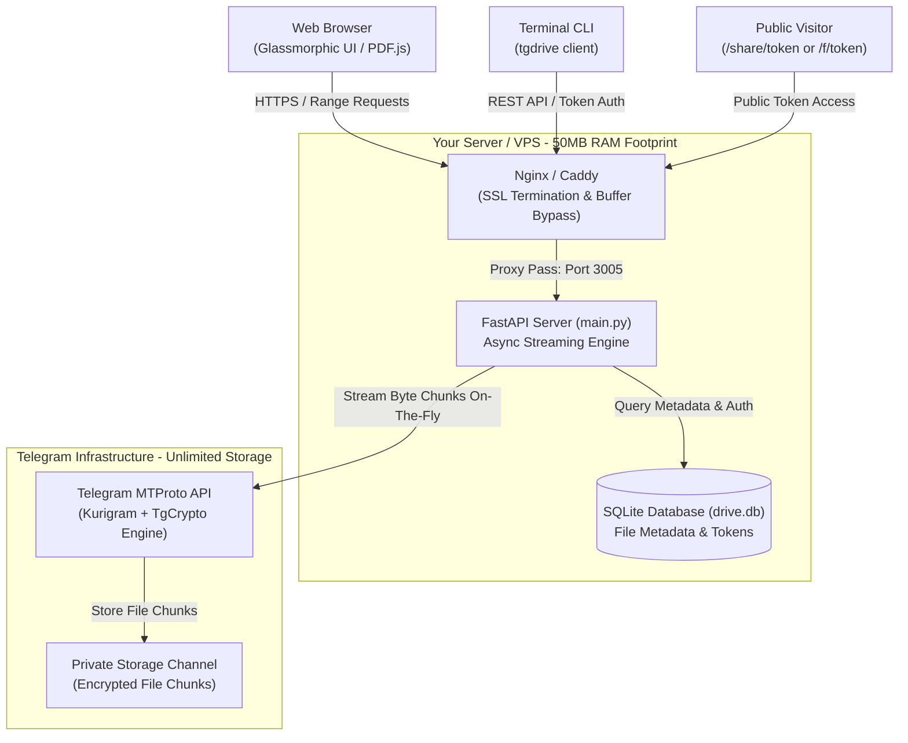
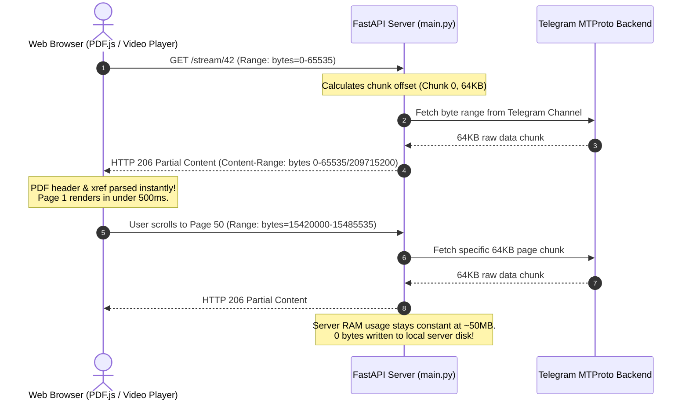
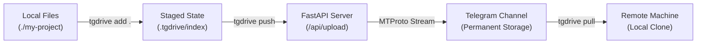
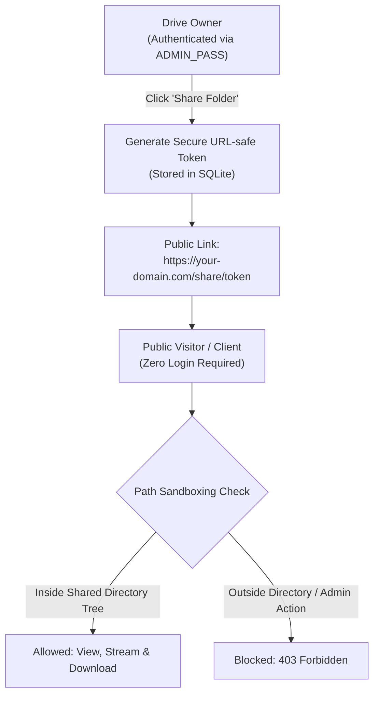

# 🚀 TG Cloud Drive

> **Made by Gourav (Hiroshi)**
> Turn any Telegram Channel into an Unlimited, High-Speed Personal & Team Cloud Storage with a Modern Glassmorphic Web UI, Git-like CLI Client, RFC 7233 Progressive Streaming, and Sandboxed Public Sharing.

[-blueviolet?style=for-the-badge&logo=github)](https://github.com/WebsiteLeLo)
[](https://drive.pwxstudy.site/share/C2J2O3sSjcFvamocFtw)
[](https://python.org)
[](https://fastapi.tiangolo.com)
[](https://docker.com)
[](https://opensource.org/licenses/MIT)

> [!TIP]
> **Live Public Folder Demo**: Explore a live shared folder hosted directly on TG Cloud Drive:
> 👉 **[https://drive.pwxstudy.site/share/C2J2O3sSjcFvamocFtw](https://drive.pwxstudy.site/share/C2J2O3sSjcFvamocFtw)** (Zero login required, instant file & code streaming!)

---

## 📑 Table of Contents

1. [✨ Key Features](#-key-features)
2. [🏗️ Architecture & Flowcharts](#️-architecture--flowcharts)
   - [System Overview](#1-system-overview)
   - [Zero-RAM Progressive Streaming (RFC 7233)](#2-zero-ram-progressive-streaming-rfc-7233)
   - [Git-like CLI Lifecycle](#3-git-like-cli-lifecycle)
   - [Public Sandboxed Link Sharing](#4-public-sandboxed-link-sharing)
3. [⚙️ Prerequisites & Telegram Setup](#️-prerequisites--telegram-setup)
4. [🚀 Quickstart (Local Development)](#-quickstart-local-development)
5. [🌐 Production Deployment Methods](#-production-deployment-methods)
   - [Method 1: Docker & Docker Compose (Recommended)](#method-1-docker--docker-compose)
   - [Method 2: PM2 Process Manager (Lightweight VPS)](#method-2-pm2-process-manager)
   - [Method 3: Linux Systemd Service](#method-3-linux-systemd-service)
   - [Method 4: Automated Sync (`deploy.sh`)](#method-4-automated-sync-deploysh)
   - [Reverse Proxy & SSL (Nginx & Caddy)](#-reverse-proxy--ssl-configuration)
6. [💻 Git-like CLI (`tgdrive`) Manual](#-git-like-cli-tgdrive-manual)
7. [🔌 REST API Reference](#-rest-api-reference)
8. [💡 Low-Resource VPS Optimization (1GB RAM Friendly)](#-low-resource-vps-optimization)
9. [🛡️ Security & Privacy Architecture](#️-security--privacy-architecture)
10. [📄 License](#-license)

---

## ✨ Key Features

* **⚡ Truly Unlimited Storage**: Powered by Telegram MTProto Cloud. Store files up to 2GB per file (4GB with Telegram Premium) with zero total capacity limits.
* **📦 0 MB Local Storage Overhead**: The server never stores uploaded files on disk. Every byte streams on-the-fly directly to/from Telegram's servers.
* **🎨 Modern Glassmorphic Web Dashboard**:
  * Dark (Obsidian / Slate) and Light mode themes with instant toggle.
  * Interactive clickable breadcrumbs navigation (`My Drive ❯ Projects ❯ WebApp`).
  * Live visual media thumbnails generated on-the-fly.
  * Omni-Search bar (`Ctrl + K` or `/`) with live instant search and type filters.
  * Drag-and-drop floating upload dock with individual upload progress trackers.
  * Batch file operations: multi-select files for **Bulk Download** or **Batch Delete**.
* **📜 Continuous Vertical PDF Reader**:
  * Native Mozilla PDF.js integration with `IntersectionObserver`.
  * **Range-based on-demand streaming**: Only visible pages are fetched. Open a 200MB PDF in milliseconds without downloading the whole file upfront!
  * Dual-ring animated loading orb and skeleton shimmer placeholders while scrolling.
* **🎬 Instant Media Streaming (RFC 7233)**:
  * Full HTTP `206 Partial Content` support with byte-range slicing.
  * Scrub and seek forward/backward in 1.5GB videos without waiting for buffering.
  * Custom styled video and audio players with theater mode.
  * Syntax-formatted code and text viewer with line numbers and 1-click **Copy Code**.
* **🔗 Sandboxed Public Link Sharing**:
  * **Public Folder Sharing**: Share any folder via a secure URL (`/share/{token}`). Guests can view, search, stream, and download files within that folder without an account or password.
  * **Instant File Sharing**: Generate direct public share links (`/f/{token}`) for individual files with integrated progressive preview.
  * **1-Click Token Revocation**: Invalidate old tokens and issue new ones instantly.
* **🤖 Interactive Telegram Bot (Direct PM Streaming)**:
  * **Upload via Telegram**: Send or forward any video, document, audio, or photo directly to your Telegram bot.
  * **Zero-Bandwidth Instant Server Cloning**: The bot clones the media into your storage channel using MTProto server-side copy in `< 100ms` without downloading or re-uploading bytes to the VPS.
  * **Instant Stream & Download Link Generation**: The bot immediately replies with:
    * 🎬 **Web Player Preview Link** (`/f/{token}`) with embedded HTML5 video player, PDF reader, and media viewer.
    * ⚡ **Direct Stream Link** (`/stream/{id}/{name}?token={token}`) for VLC, MX Player, IINA, Infuse, Kodi.
    * 📥 **High-Speed Direct Download Link** (`/dl/{id}/{name}?token={token}`).
  * **Caption-based Folder Sorting**: Add a folder path in the message caption (e.g. `/movies` or `/notes/physics`) to automatically organize files into folders in the Web Drive.
  * **Access Control**: Restrict bot upload rights with `ALLOWED_TELEGRAM_USERS` in `.env` to authorized user IDs or usernames.
* **💻 Git-like Terminal CLI (`tgdrive`)**:
  * Zero pip dependencies (pure Python 3 standard library).
  * Familiar Git commands: `init`, `add`, `status`, `push`, `pull`, `share`, `ls`.
  * Automatic `.gitignore` and `.tgignore` exclusion support.
  * Live terminal progress bars with upload speed and chunk confirmations.

---

## 🏗️ Architecture & Flowcharts

### 1. System Overview



---

### 2. Zero-RAM Progressive Streaming (RFC 7233)

How a 200MB PDF or 1.5GB 4K video streams instantly on a 1GB RAM VPS without running out of memory:



---

### 3. Git-like CLI Lifecycle



---

### 4. Public Sandboxed Link Sharing



---

## ⚙️ Prerequisites & Telegram Setup

Before running TG Cloud Drive, obtain your free Telegram credentials:

### 1. Telegram API ID & Hash
1. Log in to [https://my.telegram.org](https://my.telegram.org) with your Telegram phone number.
2. Navigate to **API development tools**.
3. Create a new application (any name/short title).
4. Copy your **`API_ID`** and **`API_HASH`**.

### 2. Telegram Bot Token
1. Open Telegram and search for [@BotFather](https://t.me/BotFather).
2. Send `/newbot` and follow the prompts to choose a name and username.
3. Copy the **`BOT_TOKEN`** provided by BotFather.

### 3. Storage Channel
1. In Telegram, create a new **Private Channel** (e.g., `My Cloud Storage`).
2. Add your newly created Bot as an **Administrator** with full permissions (Post Messages, Edit Messages, Delete Messages).
3. Obtain the Channel ID:
   * Forward any message from the channel to [@userinfobot](https://t.me/userinfobot) or [@JsonDumpBot](https://t.me/JsonDumpBot).
   * The channel ID will be a negative integer starting with `-100` (e.g., `-1001234567890`).

---

## 🚀 Quickstart (Local Development)

### 1. Clone Repository & Setup Environment
```bash
git clone https://github.com/WebsiteLeLo/tgdrive.git
cd tgdrive

# Create python virtual environment
python3 -m venv venv
source venv/bin/activate

# Install dependencies
pip install -r requirements.txt
```

### 2. Configure Environment Variables
Copy the example configuration file:
```bash
cp .env.example .env
```

Edit `.env` with your favorite text editor:
```env
API_ID="YOUR_API_ID"
API_HASH="YOUR_API_HASH"
BOT_TOKEN="YOUR_BOT_TOKEN"
CHANNEL_ID="-100xxxxxxxxxx"
ADMIN_PASS="ChangeThisToAStrongPassword"
PORT="3005"
```

### 3. Launch Server
```bash
python main.py
```
Open **[http://localhost:3005](http://localhost:3005)** in your browser!

---

## 🌐 Production Deployment Methods

### Method 1: Docker & Docker Compose

Docker ensures an isolated, reproducible setup with persistent SQLite storage.

#### 1. Setup Environment
```bash
cp .env.example .env
nano .env  # Fill in your credentials
```

#### 2. Start Services
```bash
# Build and run container in detached mode
docker compose up -d --build

# View real-time logs
docker compose logs -f

# Stop the container
docker compose down
```

The database (`drive.db`) is mounted from the host root, ensuring your metadata persists across container restarts and updates.

---

### Method 2: PM2 Process Manager

PM2 is the ideal choice for running TG Cloud Drive as a lightweight daemon on low-resource Linux VPS instances.

```bash
# 1. Install Node.js & PM2 (if not already installed)
curl -fsSL https://deb.nodesource.com/setup_20.x | sudo -E bash -
sudo apt-get install -y nodejs
sudo npm install -y pm2 -g

# 2. Setup project directory
cd /root/tg-drive
python3 -m venv venv
./venv/bin/pip install -r requirements.txt

# 3. Configure environment
cp .env.example .env
nano .env

# 4. Start with PM2
pm2 start "venv/bin/python main.py" --name "tg-drive"

# 5. Enable auto-restart on system reboot
pm2 save
pm2 startup
```

Useful PM2 commands:
```bash
pm2 status             # Check process status and RAM usage
pm2 logs tg-drive      # Tail live server logs
pm2 restart tg-drive   # Restart service
```

---

### Method 3: Linux Systemd Service

For native Linux environments without Node/PM2:

```bash
# 1. Copy service template to systemd directory
sudo cp tgdrive.service /etc/systemd/system/tgdrive.service

# 2. Edit path and user if needed
sudo nano /etc/systemd/system/tgdrive.service

# 3. Enable and start service
sudo systemctl daemon-reload
sudo systemctl enable --now tgdrive

# 4. Check status
sudo systemctl status tgdrive
```

---

### Method 4: Automated Sync (`deploy.sh`)

If you edit code locally and want to deploy changes to your VPS with a single command:

1. Copy the example deployment script:
   ```bash
   cp deploy.sh.example deploy.sh
   chmod +x deploy.sh
   ```
2. Edit `deploy.sh` with your VPS SSH credentials and remote directory.
3. Deploy updates anytime with:
   ```bash
   ./deploy.sh
   ```
*(Note: `deploy.sh` is excluded from git tracking in `.gitignore`, preventing your server IP from leaking).*

---

### 🔒 Reverse Proxy & SSL Configuration

To expose your drive safely on a custom domain with HTTPS:

#### Nginx (`/etc/nginx/sites-available/tg-drive`)

> [!IMPORTANT]
> Always disable proxy buffering (`proxy_buffering off;`) for Telegram streaming endpoints so Nginx does not buffer large video/PDF files in VPS RAM or disk!

```nginx
server {
    listen 80;
    server_name your-domain.com;
    client_max_body_size 2000M; # Support up to 2GB uploads

    location / {
        proxy_pass http://127.0.0.1:3005;
        proxy_http_version 1.1;

        # WebSocket & connection upgrade support
        proxy_set_header Upgrade $http_upgrade;
        proxy_set_header Connection "upgrade";

        # Standard proxy headers
        proxy_set_header Host $host;
        proxy_set_header X-Real-IP $remote_addr;
        proxy_set_header X-Forwarded-For $proxy_add_x_forwarded_for;
        proxy_set_header X-Forwarded-Proto $scheme;

        # Disable buffering for instant streaming without RAM spikes
        proxy_buffering off;
        proxy_cache off;
        proxy_read_timeout 600s;
        proxy_send_timeout 600s;
    }
}
```

Enable site & issue free SSL via Certbot:
```bash
sudo ln -s /etc/nginx/sites-available/tg-drive /etc/nginx/sites-enabled/
sudo nginx -t && sudo systemctl reload nginx
sudo certbot --nginx -d your-domain.com
```

#### Caddy (`/etc/caddy/Caddyfile`)

Caddy automatically provisions and renews SSL certificates:

```caddy
your-domain.com {
    reverse_proxy 127.0.0.1:3005 {
        transport http {
            read_buffer 8192
        }
    }
}
```

---

## 💻 Git-like CLI (`tgdrive`) Manual

The `tgdrive` CLI gives you terminal superpowers to upload, sync, and deploy entire directories to your cloud just like Git.

### 1. Installation

The CLI requires **zero pip packages** and runs on Python 3:

```bash
# Install globally (recommended):
sudo cp tgdrive /usr/local/bin/tgdrive
sudo chmod +x /usr/local/bin/tgdrive

# Or install for your current user:
mkdir -p ~/.local/bin
cp tgdrive ~/.local/bin/tgdrive
chmod +x ~/.local/bin/tgdrive
```

Verify installation:
```bash
tgdrive help
```

---

### 2. Step-by-Step CLI Workflow

#### Step 1: Connect to your Remote Server
Run this once to link your local CLI to your TG Cloud Drive:
```bash
tgdrive remote set https://your-domain.com YOUR_ADMIN_PASSWORD
```

#### Step 2: Initialize Folder Tracking (`git init` equivalent)
In your local project directory:
```bash
cd /path/to/my-project
tgdrive init /apps/my-project
```
*(Creates a lightweight `.tgdrive` mapping file)*.

#### Step 3: Stage Files (`git add .` equivalent)
```bash
# Stage all files (respects .gitignore and .tgignore):
tgdrive add .

# Or stage specific files:
tgdrive add index.html app.js assets/
```

#### Step 4: Review Staged Files (`git status` equivalent)
```bash
tgdrive status
```

#### Step 5: Push Files to Cloud (`git push` equivalent)
```bash
tgdrive push
```
*Live terminal output:*
```text
Pushing 3 files (1.2 MB) to:
  Remote: https://your-domain.com
  Target: /apps/my-project

  ↑ index.html       [####################] 100% (2.4 KB/2.4 KB)  ✔
  ↑ bundle.js        [####################] 100% (450 KB/450 KB)  ✔
  ↑ banner.png       [####################] 100% (750 KB/750 KB)  ✔

✔ Push complete! Successfully deployed 3/3 files.
```

#### Step 6: Pull Files on Another Machine (`git pull` equivalent)
```bash
# Download all files from remote folder into current directory:
tgdrive pull /apps/my-project .
```

#### Step 7: Get Public Share Link from Terminal
```bash
tgdrive share /apps/my-project
```

---

### 3. CLI Command Reference

| Command | Arguments | Description |
| :--- | :--- | :--- |
| `tgdrive remote set` | `<url> <pass>` | Save remote server URL & admin password |
| `tgdrive remote show` | — | Display current remote connection info |
| `tgdrive init` | `[remote_path]` | Initialize folder mapping in current directory |
| `tgdrive status` | — | View staged files and sync status |
| `tgdrive add` | `<file\|dir\|.>` | Stage files or directories for upload |
| `tgdrive reset` | — | Unstage all staged files |
| `tgdrive push` | `[file\|.] [-f /dir]` | Upload staged or specified files to remote folder |
| `tgdrive pull` | `[remote_folder] [dir]` | Download files from cloud to local filesystem |
| `tgdrive ls` | `[remote_folder]` | List remote files and subdirectories |
| `tgdrive share` | `[remote_folder]` | Generate public sharing link for a folder |
| `tgdrive link` | `<file_id>` | Get instant public preview link for a single file |
| `tgdrive info` | — | Print cloud storage statistics and file count |

---

### 4. Ignoring Files (`.tgignore`)

`tgdrive` automatically respects `.gitignore` and `.tgignore`:

Create a `.tgignore` file in your project directory:
```gitignore
# Ignore virtual environments & modules
node_modules/
venv/
__pycache__/

# Ignore secrets & credentials
.env
*.pem
*.key

# Ignore local builds
dist/
build/
*.tmp
```

---

## 🔌 REST API Reference

All admin endpoints require the `x-auth: YOUR_ADMIN_PASS` header or `?key=YOUR_ADMIN_PASS` query parameter.

| Endpoint | Method | Auth | Description |
| :--- | :--- | :--- | :--- |
| `/api/files?folder=/` | `GET` | Admin | List files and subfolders in specified directory |
| `/api/files?all_files=true` | `GET` | Admin | List all files across the entire drive |
| `/api/upload` | `POST` | Admin | Multipart upload (`file`, `folder`) |
| `/api/files/{id}` | `DELETE` | Admin | Delete file from database and Telegram channel |
| `/api/files/batch-delete` | `POST` | Admin | Bulk delete multiple files (`{"ids": [1, 2, 3]}`) |
| `/api/folders` | `POST` | Admin | Create directory path (`{"path": "/..."}`) |
| `/api/folders` | `DELETE` | Admin | Delete folder & all its nested contents |
| `/api/folders/share-token` | `GET` | Admin | Get or generate share token for a directory |
| `/api/folders/share-token/regenerate` | `POST` | Admin | Invalidate old token and issue a fresh share link |
| `/api/share/{token}` | `GET` | **Public** | Fetch files & subdirectories for shared folder |
| `/share/{token}` | `GET` | **Public** | Render web dashboard in public sandboxed mode |
| `/api/f/{token}` | `GET` | **Public** | Fetch metadata for single shared file |
| `/f/{token}` | `GET` | **Public** | Instant standalone preview page for shared file |
| `/stream/{message_id}` | `GET` | Token/Admin | RFC 7233 byte-range streaming endpoint |

---

## 💡 Low-Resource VPS Optimization

TG Cloud Drive is engineered to run seamlessly on budget cloud servers ($3–$5/month, 1 vCPU, 1 GB RAM, 10 GB disk):

1. **Zero Disk Caching**: Streaming uses Telegram MTProto chunk iterators. File bytes are piped straight to the client socket without touching local disk storage.
2. **Predictable Memory Footprint**: Memory usage stays under **60 MB** even when streaming large 2GB media files.
3. **Async Concurrency**: Built with Python `asyncio` and `uvicorn`, handling multiple concurrent streaming connections effortlessly.
4. **Lightweight Database**: Uses SQLite in Write-Ahead-Logging (`WAL`) mode with indexing on file paths and share tokens for sub-millisecond query responses.

---

## 🛡️ Security & Privacy Architecture

* **Private Channel Isolation**: All files reside inside your own private Telegram channel. No third party or public entity can view or list files without your authorization.
* **Cryptographic URL-safe Tokens**: Share tokens are generated with Python `secrets.token_urlsafe(16)` (high entropy).
* **Directory Traversal Protection**: Folder sharing strictly enforces prefix boundaries. Guests cannot traverse upwards or inspect siblings outside their designated shared folder.
* **Secret Sanitization**: No sensitive credentials are hardcoded into the source code. All secrets are loaded from environment variables (`.env`).

---

## 👨‍💻 Author & Credits

* **Made by Gourav (Hiroshi)**
* GitHub: [@WebsiteLeLo](https://github.com/WebsiteLeLo)

---

## 📄 License

This project is licensed under the [MIT License](LICENSE) — free to use, modify, and distribute for personal and commercial projects.
